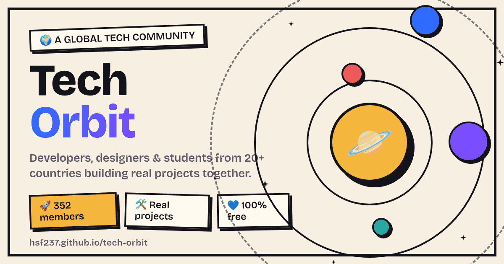

# 🪐 Tech Orbit



**A free, global tech community** — developers, data analysts, designers, AI & robotics geeks, students and working professionals, all in one place. Members from 20+ countries.

🌐 **Live site:** [hsf237.github.io/tech-orbit](https://hsf237.github.io/tech-orbit/)

---

## ✨ Features

| | |
|---|---|
| 📱 **Installable PWA** | Add Tech Orbit to your home screen — works offline too (service worker caches the whole app) |
| 🌍 **4 languages** | English, Malayalam, हिन्दी, العربية (with full RTL support) |
| 🌗 **Dark mode** | Toggle with 🌙 — remembers your choice |
| 🎉 **Events** | Community meetup Oct 30 with a live countdown |
| 👾 **Playful UI** | Confetti bursts, tilt cards, starfield with shooting stars, orbit splash screen |
| 📊 **Road to 500** | Live member goal tracker + confetti storm when the goal drops 🎉 |
| 🔍 **Quick search** | Press `/` (or the 🔍 button) to search the whole site |
| ⌨️ **Shortcuts** | `g`+`h` home · `g`+`e` events · `d` dark mode · 5× logo tap or Konami code for a secret 🪐 |
| 🤖 **Orbit buddy** | A friendly planet pops up with one tip a day |
| 🗨️ **WhatsApp-first** | Join the hub and talk to us directly |
| ♿ **Accessible** | Focus rings, ARIA labels, respects reduced-motion settings |

## 🗂️ Pages

Home · About (our story) · Events · Projects · Groups · Learn · Join

## 🛠️ Tech

The entire app is **one self-contained `index.html`** — no build step, no frameworks, no dependencies. Plain HTML + CSS + vanilla JS with hash routing.

Supporting assets: `manifest.webmanifest`, `sw.js`, `og.png`, `icon-192.png`, `icon-512.png`, `404.html`.

Every push is validated by CI (`.github/workflows/check.yml` → `scripts/checks.py`).

## 🚀 Run locally

```bash
# just open it, or serve it for the full PWA experience:
python3 -m http.server 8000
# → http://localhost:8000
```

> Service workers need `https://` or `localhost`.

## 📈 Analytics

The site ships with a [GoatCounter](https://www.goatcounter.com/) loader (privacy-friendly, no cookies). To activate:

1. Create a free account and pick a site code (e.g. `techorbit`)
2. In `index.html`, find `const GC=""` and set it: `const GC="techorbit"`

## 🤝 Contributing

Ideas and bug reports welcome — open an issue or ping us in the WhatsApp hub!

## 📄 License

© Tech Orbit community. All rights reserved.

## 🌐 Custom domain (optional)

1. Buy a domain (e.g. `techorbit.app`)
2. Repo **Settings → Pages** → Custom domain → enter it
3. At your DNS provider add: `A` records → `185.199.108.153`, `185.199.109.153`, `185.199.110.153`, `185.199.111.153` (or `CNAME` → `HSF237.github.io`)
4. Enable **Enforce HTTPS** once the certificate is issued

## 🏷️ Versioning

Each release is tagged (`v1.0`, `v1.1`, …) — the live version badge is in the site footer. To roll back: re-point a tag or revert a commit; Pages redeploys automatically.
